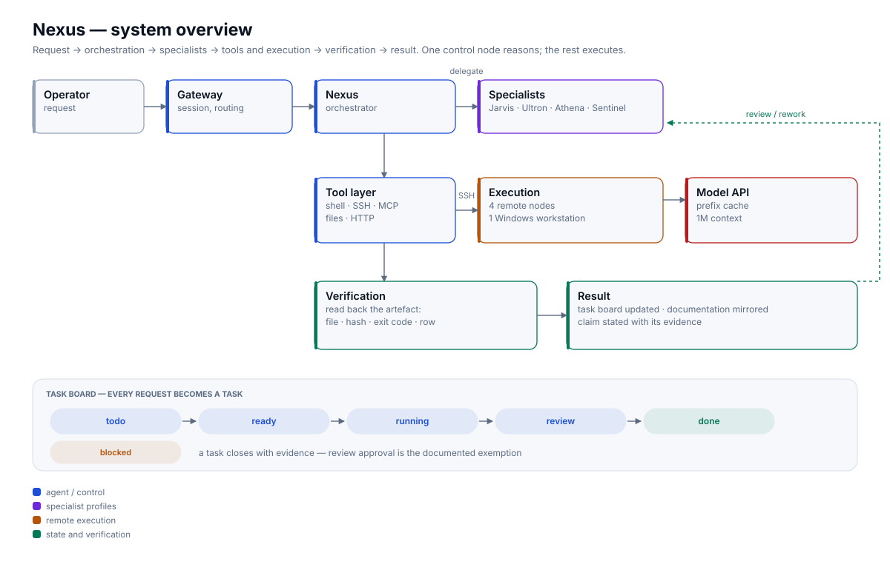
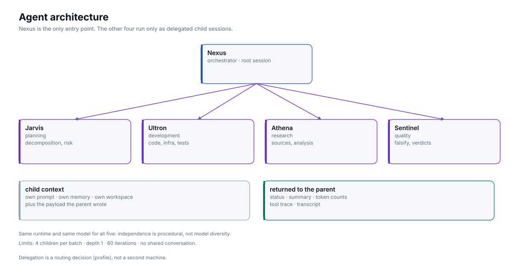
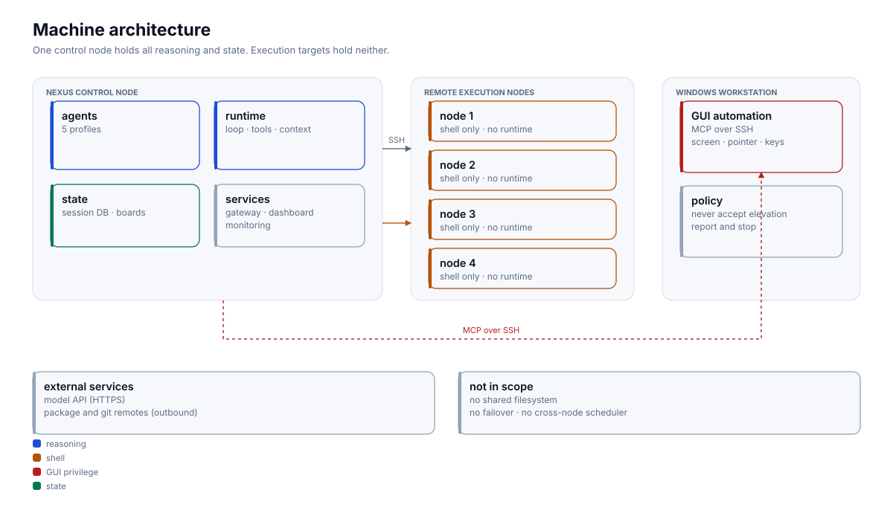
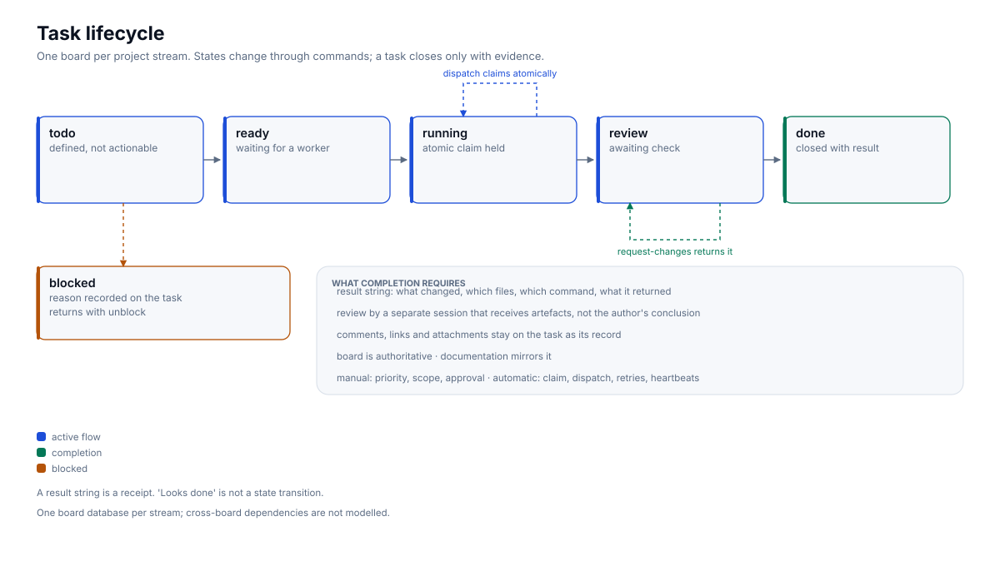
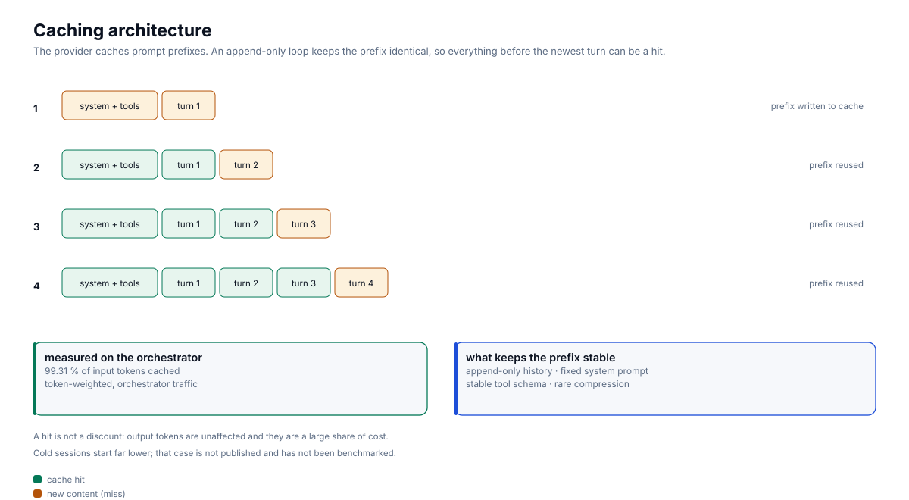
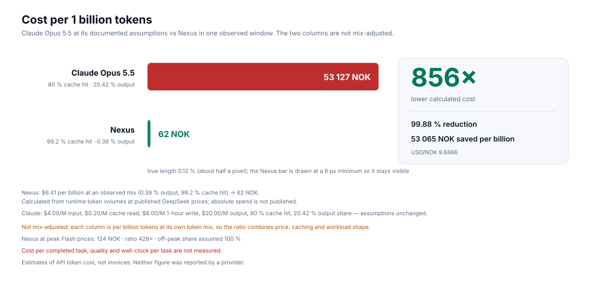

# NEXUS AI SYSTEM

**A self-hosted multi-agent orchestration system.** One orchestrator plans and delegates, four
specialist profiles execute, remote machines run the commands, and every result is read back
before it is called done.

**Licence:** GPL-3.0-only · **Status:** private, pre-release



---

## WHAT THIS REPOSITORY IS

This is the **architecture and verification repository** for a working Nexus installation. It
contains:

- the system design: agents, orchestration, task board, caching and cost model;
- the diagrams, generated from source;
- the tooling that verifies all of it — a publication/secret scanner, a cost calculator, a link
  checker and a diagram validator, each with tests.

It does **not** contain the agent runtime itself. Nexus runs on a Hermes installation, which is
a separate program; nothing here can be `pip install`ed and used as an agent. What you can do is
read the design, run the numbers and re-run every check that guards this documentation.

## THE PROBLEM IT SOLVES

A single long-running agent accumulates context until cost and coherence collapse: every turn
re-sends everything, quality drifts, and one session has to hold planning, implementation,
research and review at once. Nexus splits that into an orchestrator plus four specialist
profiles, keeps each context small and focused, executes shell work on machines that hold no
credentials, and records every task on a durable board so work survives a restart.

## WHY NEXUS?

- **One coordinator, five contexts.** Nexus orchestrates; Jarvis, Ultron, Athena and Sentinel
  work inside their own session, persona and workspace.
- **Append-only conversation.** History is only extended, never rewritten — which is what makes
  provider-side prompt caching work.
- **Execution is distributed, reasoning is not.** Remote nodes run shell commands; no model runs
  anywhere but the control node.
- **Tasks are durable.** A SQLite-backed board holds state, claims tasks atomically and closes
  them only with evidence.
- **Costs are calculated, not asserted.** One comparison, one workload, every assumption written
  down — and the calculator is in the repository.

## ARCHITECTURE OVERVIEW

| Layer | What it does | Where |
|---|---|---|
| Interface | Chat gateway, dashboard, local API | Control node |
| Orchestration | Task intake, delegation, verification | Control node |
| Specialists | Planning, implementation, research, QA | Control node |
| Runtime | Conversation loop, tools, context, session store | Control node |
| Execution | Local shell, SSH targets, GUI automation | Control node + targets |
| Model | One provider connection with automatic prefix cache | External API |

Deeper: [architecture](docs/architecture.md) · [infrastructure](docs/infrastructure.md)

## FIVE AGENTS — ONE ORCHESTRATOR, FOUR SPECIALISTS

| Agent | Role | Responsibility |
|---|---|---|
| **Nexus** | Orchestrator | Understands the request, plans, delegates, verifies, assembles |
| **Jarvis** | Planning | Decomposition, dependencies, risk, stop conditions |
| **Ultron** | Development | Code, infrastructure, tests, debugging |
| **Athena** | Research | Sources, technical analysis, documentation |
| **Sentinel** | Quality assurance | Falsification, security review, per-claim verdicts |



They are **profiles in one installation**, not five servers, and they run the **same model and
the same tool configuration**. A delegated child gets its own persona, memory and workspace,
plus the payload its parent wrote — and nothing else. Independence in review is procedural, not
model-based, and a role is not a privilege boundary.

Deeper: [roles](docs/roles.md)

## HOW THE ORCHESTRATOR WORKS

1. A request arrives on the gateway and becomes a session with its own transcript.
2. Nexus decides whether one context can finish the work.
3. Independent parts are delegated: the child gets a goal, a payload, and a profile to run as.
4. Tools run — locally, over SSH, or through the GUI layer.
5. Results are read back — file, hash, exit code, row — before anyone calls them done.
6. The task board records the outcome; documentation mirrors the board.

Limits are deliberate: four children per batch, one level of delegation, 60 iterations each, and
a child cannot delegate further. Deeper: [kanban](docs/kanban.md)

## STATE AND MEMORY

| Store | Holds | Lifetime |
|---|---|---|
| Session store | One row per conversation, with per-model token accounting | Persistent |
| Task boards | One SQLite board per project stream; authoritative task state | Persistent |
| Profile memory | Durable notes per profile, injected each turn | Persistent |
| Context window | The live conversation, append-only | One session |

Nothing is shared between a parent and a child beyond the payload the parent writes. That is why
a delegated agent cannot "remember" what the orchestrator never told it.

## MODEL INTEGRATION

One provider connection serves all profiles. Requests are stateless chat completions with tool
schemas; the provider keeps a prompt-prefix cache, which is the only cache in the system. Model
names, prices and context limits are documented in [economics](docs/economics.md); no endpoint,
credential or account identifier is part of this repository.

## MACHINE INFRASTRUCTURE



One control node holds all reasoning and state. Four remote nodes are shell targets with no
runtime and no credentials. One Windows workstation exposes GUI automation through an MCP server
started over SSH. There is no shared filesystem, no failover and no cross-node scheduler.

Deeper: [infrastructure](docs/infrastructure.md)

## TASK ORCHESTRATION



`todo → ready → running → review → done`, plus `blocked`, `scheduled`, `triage` and `archived`.
A dispatcher claims ready tasks atomically; `complete` is refused unless it carries a non-empty
result (approving out of `review` is the one exemption). The CLI checks that evidence exists,
not what it says — that is the reviewer's job. Review is a separate session that receives
artefacts, not the author's conclusion.

## PERFORMANCE AND CACHING



| Metric | Value |
|---|---|
| Cache-hit rate, orchestrator | **99.31 %** of input tokens |
| Scope | the orchestrator's own API calls, token-weighted |

The provider caches prompt prefixes; the agent loop only appends, so every token before the
newest turn is a candidate hit. This is a **fixed measurement over a recorded set of calls**, not
a live average and not a benchmark; the underlying counters are not published. A hit rate is
also **not** a discount: output tokens are unaffected. The figure covers the orchestrator's own
traffic; delegated child sessions are separate and excluded. The cost model below uses a
different, shorter window (99.2 %) — see [caching](docs/caching.md).

## COST MODEL



| | Claude Opus 5.5 | Nexus |
|---|---|---|
| Cache hit | 80 % | **99.2 %** (cost window) |
| Output share | 20.42 % (assumed) | **0.39 %** (observed) |
| Cost per 1 billion tokens | **53 127 NOK** | **62 NOK** |

**856× lower calculated API token cost · 99.88 % reduction · 53 065 NOK difference per billion
tokens.**

The Nexus figure is a normalised rate — **$6.41 per billion tokens → 62 NOK** — from one
aggregated, undated observation (0.39 % output, 99.2 % of input cached), calculated from runtime
token volumes at published DeepSeek prices. Absolute spend and raw volumes are not published; the
rate and the mix are. It is not a provider report and not an invoice. Because the output share is
only ~0.39 %, it is **not** a general price per billion tokens.

Claude keeps its documented assumptions: Opus 5.5 at $4.00/M input, $0.20/M cache read, $8.00/M
one-hour cache write, $20.00/M output, 80 % cache hit and a 20.42 % output share, USD/NOK 9.6866.
Prices: [Claude](https://platform.claude.com/docs/en/about-claude/pricing) ·
[DeepSeek](https://api-docs.deepseek.com/quick_start/pricing). At peak Flash prices the Nexus
column is 124 NOK and the ratio 428×.

The two columns are **not mix-adjusted** — each is per billion tokens at its own token mix — so
856× combines model price, caching and workload shape. These are **estimates of API token cost,
not invoices**, and not evidence that Nexus is 856× smarter, faster or better at tasks. Reproduce
with [`calculations/recompute.py`](calculations/recompute.py). Deeper: [economics](docs/economics.md)

## SECURITY

- Content is data, never instruction. Credentials stay on the control node and never reach
  execution nodes.
- GUI automation is high privilege: the policy is report-and-stop, never accept an elevation
  prompt.
- Publication requires a clean fail-closed scan of the working tree, the git index, every commit,
  ref, path and identity, plus isolated tests. It runs locally and in the `publication-check`
  workflow; neither is a git hook, and neither can prove that a scan found everything.

**Not measured:** cost per completed task · quality per task · net effect of delegation ·
deferred-tool effect · cold provider cache · effect of review on error rate.

Deeper: [security](docs/security.md) · report a vulnerability per [SECURITY.md](SECURITY.md)

## REQUIREMENTS

- Python **3.9+** (standard library only, no third-party packages)
- Git
- Any OS with a POSIX shell; the tooling is pure Python and portable

Optional: `gitleaks` or `detect-secrets`, if you want a second opinion on the scanner.

## CONFIGURATION

None. The repository is documentation and tooling: there are no environment variables, no
config files, no credentials and no network calls in any script. Every path is taken from the
repository root.

## HOW TO RUN IT

There is nothing to install. From the repository root:

```bash
python3 calculations/recompute.py             # the cost comparison, from published prices
python3 tools/scan_publication.py --history   # scan tree, index, history, names
python3 tools/check_links.py                  # every relative link resolves
python3 tools/check_diagrams.py               # every SVG parses and fits its canvas
```

Regenerate the diagrams after changing any figure:

```bash
python3 diagrams/render.py
```

## HOW TO VERIFY IT

The tests are the contract. They build throwaway repositories in a temporary directory and
assert the scanner's verdict, not that a function was called.

```bash
python3 tools/test_scan_publication.py   # 77 cases: bypasses, fail-closed states, names, refs
python3 tools/test_recompute.py          # 33 cases: published figures and argument validation
```

All six commands above also run in `.github/workflows/publication-check.yml` on every push.

## REPOSITORY LAYOUT

```
README.md          this file
LICENSE            GNU GPL v3.0 (unmodified)
SECURITY.md        vulnerability reporting and the publication gate
CONTRIBUTING.md    how to propose a change
docs/              seven documents: architecture, roles, infrastructure, kanban,
                   caching, economics, security
diagrams/          seven SVGs plus render.py, which generates them
calculations/      recompute.py, the cost calculator
tools/             scanner, its tests, link checker, diagram validator, calculator tests
.github/           the publication-check workflow and dependency updates
```

## CONTRIBUTING

Issues and pull requests are welcome. Read [CONTRIBUTING.md](CONTRIBUTING.md) first: it covers
the development setup, the conventions (standard library only, no secrets, tests for behaviour),
and what a reviewable pull request looks like.

## LICENCE

Nexus is free software: you can redistribute it and/or modify it under the terms of the **GNU
General Public License, version 3.0 only** (SPDX: `GPL-3.0-only`), as published by the Free
Software Foundation.

The full licence text is in [LICENSE](LICENSE). It is distributed WITHOUT ANY WARRANTY; without
even the implied warranty of MERCHANTABILITY or FITNESS FOR A PARTICULAR PURPOSE. See the
licence for details.

Copyright (C) 2026 NEXUS project contributors.
