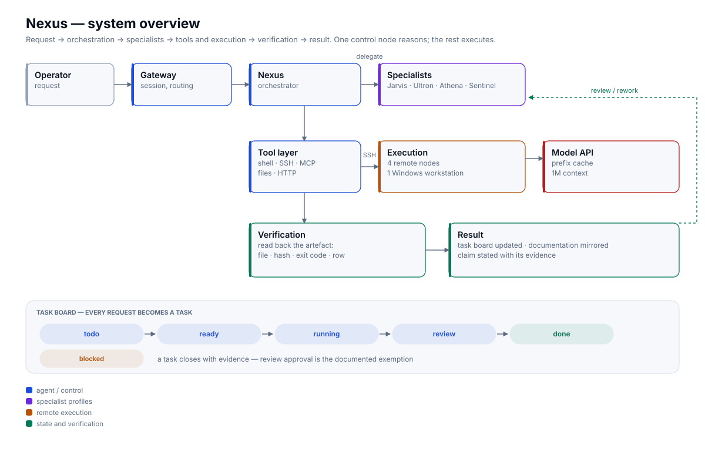

# Architecture

**What it is:** one control node that runs every agent, plus execution targets that run
commands. Reasoning is centralised; execution is not.

**Scope of this repository:** it documents the design and ships the tooling that verifies the
documentation. The agent runtime itself is a separate installation and is not distributed here.

## Layers

| Layer | Contents | Runs where |
|---|---|---|
| Interface | Chat gateway, dashboard, local HTTP API | Control node |
| Orchestration | Nexus (root agent), task board integration | Control node |
| Specialists | Jarvis, Ultron, Athena, Sentinel (profiles) | Control node |
| Runtime | Conversation loop, tool executor, context manager, session store | Control node |
| Execution | Local shell, remote shells, GUI automation | Control node + targets |
| Model | One provider connection, shared by all profiles | External API |

## Request flow

1. A request arrives on the gateway and becomes a **session** with its own transcript.
2. Nexus decides whether one context can finish the work.
3. Independent parts are **delegated**: a child session starts in a named profile with its
   own persona, memory, workspace and a payload written by the parent.
4. Tools execute — locally, over SSH, or through the GUI layer.
5. Results are **verified by readback**: file, hash, exit code, row or HTTP status.
6. State is recorded in the task board; documentation mirrors it.

## Delegation contract

| Field | Meaning |
|---|---|
| `goal` | the single outcome the child must produce |
| `context` | everything the child needs — it inherits nothing else |
| `profile` | routing: which profile's configuration runs the child |
| `output_schema` | optional schema the answer must validate against |

Limits: four children per batch, one level deep, 60 iterations each. A child cannot delegate.

**No per-agent tool separation.** Every profile ships the same configuration file: same model,
same provider, same tool layer, same MCP servers, no allow- or deny-lists. Roles differ by
persona, memory, skills and workspace — a matter of instructions and context, not of enforced
privilege. Anything one profile can do, the others can do. The security boundary is around the
whole installation, not between agents.

## State

- **Sessions.** One row per conversation, with token accounting per model.
- **Task boards.** SQLite-backed, one board per project stream; task state is authoritative
  there, not in prose.
- **Monitoring.** Per-model usage rows live in the session store; uptime probes are kept by a
  separate monitoring service, so one can check the other.

## Implemented vs planned

| Implemented | Planned / not implemented |
|---|---|
| Single-node orchestration, five profiles | Multi-node agents |
| Profile-based delegation, depth 1 | Recursive delegation |
| SSH execution, GUI automation over SSH | Shared filesystem between nodes |
| Provider prefix caching (automatic) | A custom cache layer |
| Task board with dispatch and review | Cross-node task queue |
| Publication scanner + tests | Automated dependency pinning |

→ [Roles](roles.md) · [Infrastructure](infrastructure.md) · [Kanban](kanban.md) · [Caching](caching.md)
