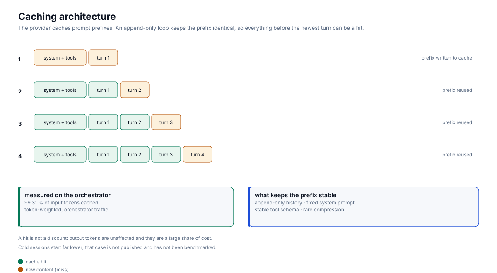

# Caching

**What it is:** the model provider keeps a disk cache of prompt prefixes. A request that
starts with a prefix it has already seen pays a small fraction of the miss price — 1/20 at
Claude Opus 5.5 prices ($0.20 vs $4.00 per million), 1/50 at DeepSeek Flash prices ($0.003 vs
$0.15).

## How it works

1. Each request re-sends the whole conversation: system prompt, tool schemas, memory, then the
   transcript.
2. The provider matches a **prefix** byte-for-byte against a stored prefix unit and stops at
   the first difference.
3. An agent loop only appends, so the previous request is a prefix of the next one — every
   token before the newest turn is a candidate hit.
4. The cache is best-effort and expires when unused. This is the provider's cache; the client
   adds no cache of its own.

## What keeps the prefix stable

| Choice | Effect |
|---|---|
| Append-only history | earlier turns stay byte-identical |
| Fixed system prompt per profile | same opening block every session |
| Stable tool schema, fixed order | no reordering that breaks the prefix |
| Rare, late compression | one invalidation instead of one per turn |
| Small, capped memory block | less to rewrite near the top |

## What breaks it

Editing history, pruning tool results in place, adding or reordering tools, rewriting memory,
and compacting the middle of a conversation. Each turns cheap cached tokens into full-price
misses for that call and every later call in the session.

## The measurement

| Quantity | Value |
|---|---|
| Cache-hit ratio, orchestrator agent | **99.31 %** of input tokens |
| Weighting | token-weighted, not an average of per-call percentages |
| Source | provider-reported cached portion, per call, recorded by the runtime |

Method: the runtime records, per API call, the input tokens and the cached portion reported by
the provider. The figure is `cached ÷ input` over that recorded set — a fixed measurement, not
a live average and not a benchmark. The counters and raw logs are not part of this repository,
so the number cannot be re-derived here; that limitation is deliberate, because the counters
are one account's usage.

## What it is worth — and what it is not

At these prices a miss costs 50× a hit (Flash) or 20× a hit (Claude Opus 5.5), so caching can
cut input cost by up to that factor — and at 99.31 % the input line is about 37× cheaper than
with no cache at all.

- A hit rate is **not** a discount on the bill: output tokens are unaffected and are a large
  share of cost.
- The last points are worth little: 90 % → 99.3 % improves input cost by about 4×, while
  95 % → 99.3 % improves it by about 2.5×.
- The high ratio comes from long sessions continuing, not from reusing context across
  sessions. A genuinely cold session starts far lower — that behaviour is not published here
  and has not been measured against an expired provider cache.
- **Scope.** 99.31 % is the orchestrator agent's own traffic. Delegated child sessions are
  separate sessions with their own cold start and are excluded from the figure.
- **Two windows.** The cost model in [economics](economics.md) uses a separate, shorter window
  in which 99.2 % of input tokens were hits. The percentages differ because the windows do;
  both are around 99 %.

→ [Economics](economics.md) · [Architecture](architecture.md)
