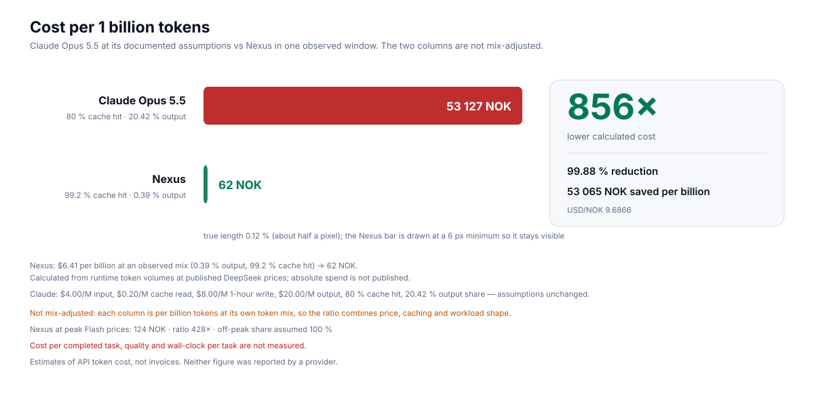

# Economics

**What it is:** two columns, one unit — a billion tokens. Claude at published prices with an
assumed workload shape; Nexus from one observed window, normalised the same way.



| | Claude Opus 5.5 | Nexus |
|---|---|---|
| Cache hit | 80 % | **99.2 %** (cost window) |
| Output share | 20.42 % (assumed) | **0.39 %** (observed) |
| Cost per 1 billion tokens | **53 127 NOK** | **62 NOK** |

**856× lower calculated API token cost · 99.88 % reduction · 53 065 NOK difference per billion
tokens.**

## The Nexus number

| Observed, aggregated | Value |
|---|---|
| Output share | **0.39 %** of tokens |
| Cache hit | **99.2 %** of input tokens |
| Model | DeepSeek Flash (`deepseek-flash`) |
| Normalised cost | **$6.41 per billion → 62 NOK** |

The rate comes from one aggregated, undated observation window: token volumes from the
runtime's API logs, priced at the published DeepSeek list prices. The absolute spend and the
raw volumes are deliberately not published — a normalised rate plus the token mix is all the
comparison needs, and it keeps a private account out of a public document (see
[security](security.md)). It is a calculated cost, not an invoice, not a provider usage report,
and no account balance is part of it.

The output share is unusually low — about one output token per 257 input tokens. That mix is
what makes 62 NOK possible, so the figure is **not** a general price per billion tokens; it
belongs to this workload.

## The Claude assumptions (unchanged)

| Parameter | Value |
|---|---|
| Model | Claude Opus 5.5 |
| Base input | $4.00 / M |
| Cache read | $0.20 / M (0.05×) |
| 1-hour cache write | $8.00 / M (2×) |
| Output | $20.00 / M |
| Cache hit | 80 % of input |
| Output share | 20.42 % of total — a chosen assumption, not a measurement |
| Currency | USD/NOK 9.6866 |

Sources: [Claude](https://platform.claude.com/docs/en/about-claude/pricing) and
[DeepSeek](https://api-docs.deepseek.com/quick_start/pricing). Verify before quoting.

## The arithmetic

```
Claude   795.8 M × 0.80 × 0.20 =  127.33
         795.8 M × 0.20 × 8.00 = 1 273.28
         204.2 M        × 20.00 = 4 084.00     total 5 484.61 USD = 53 127 NOK

Nexus    6.41 USD per billion × 9.6866 = 62 NOK
```

Cross-check: one billion tokens at the observed mix (0.39 % output, 99.2 % of input cached)
costs `996.1 × 0.9931 × 0.003 + 996.1 × 0.0069 × 0.15 + 3.9 × 0.60 = $6.47` at list prices —
0.9 % above the stated rate, because the mix is published rounded to two decimals.

`calculations/recompute.py` reproduces both columns and accepts `--fx`, `--mix` and
`--claude-hit` for other assumptions.

## Where the difference comes from

| Factor | Effect |
|---|---|
| Cache hit, 80 % → 99.2 % | ×1.28 |
| Model price, Opus 5.5 → Flash | ×34 |
| Token mix, 20.42 % → 0.39 % output | ×19.6 |

`1.28 × 34.1 × 19.6 ≈ 855`, and 856 with unrounded factors.

Model price does most of the work, then the workload's low output share. Prompt caching helps
least of the three.

## What these numbers are not

- **Not mix-adjusted.** Claude is priced at a 20.42 % output share, Nexus at 0.39 %. The two
  columns are per billion tokens at *each system's own* mix, so 856× combines price, caching
  and workload shape. Applying Claude's 20.42 % share to Flash prices would give a far smaller
  ratio.
- **Not invoices.** Both are calculated from published prices and measured volumes.
- **Not a benchmark.** No controlled test ran the same tasks on both systems.
- **Not cost per task.** Cost per completed task, quality per task and wall-clock per task are
  not measured for either system.
- **Not peak-adjusted.** The Nexus figure uses 100 % off-peak Flash prices. At peak prices (2×)
  it is **124 NOK** per billion and the ratio **428×** (reduction 99.77 %).

The defensible sentence: *in the observed window, the calculated API token cost was about 62
NOK per billion tokens, against 53 127 NOK for Claude Opus 5.5 under its documented
assumptions — a difference driven mainly by model price and by a much lower output share.*

→ [Caching](caching.md) · [Security](security.md)
