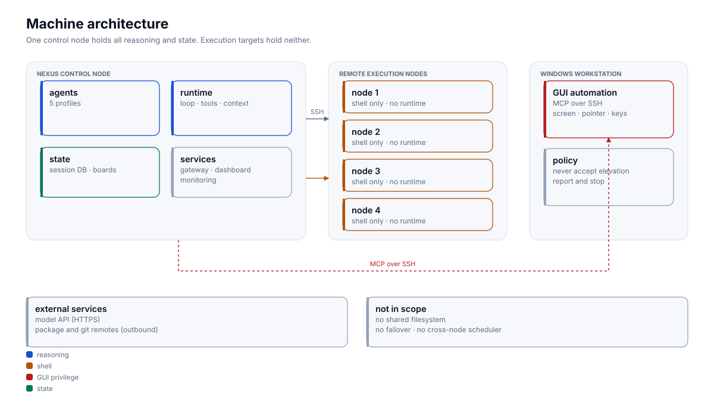

# Infrastructure

**What it is:** one AI host, four shell targets, one Windows workstation. Only the first
reasons.

## Nodes

| Role | Count | Characteristics | Runs |
|---|---|---|---|
| Nexus control node | 1 | small always-on host, no GPU | All agents, runtime, state, monitoring |
| Remote execution nodes | 4 | modest hosts | Shell commands only — no runtime, no model access |
| Windows workstation | 1 | ordinary desktop | GUI automation targets |

## Transports

| Link | Direction | Payload |
|---|---|---|
| Gateway ↔ operator | inbound chat/API | messages |
| Control node → model API | outbound HTTPS | prompts and tool schemas |
| Control node → execution nodes | outbound SSH | one command in, bytes and exit code out |
| Control node → Windows workstation | outbound SSH + MCP | GUI tool calls |

Remote targets are reached with non-interactive SSH; the control node initiates every
connection. The Windows side exposes an **MCP server started over that connection** — screen
capture, pointer, keyboard, window inspection. SSH is the only inbound service on the targets;
nothing listens back for tool traffic.

## Services on the control node

| Service | Purpose |
|---|---|
| Agent gateway | messaging adapters, session multiplexing, dispatch |
| Dashboard | read-only view over sessions |
| Monitoring | uptime probes and usage ingestion |

## What this is not

- Not a distributed AI system: no model runs off the control node.
- Not a cluster: no shared filesystem, no failover, no scheduler across nodes.
- Not horizontally scalable: a second control node would need a shared state store first.
- Not containerised: the request path runs as host processes. Container tooling on the host is
  not part of that path and is not claimed here.

## Why distribute at all

1. **Blast-radius isolation** — mutating work can run somewhere that is not the AI host.
2. **Platform reach** — some work must happen on a specific OS or machine.
3. **Parallel wall-clock** — independent commands finish sooner in parallel.

## Limits

Single point of failure (the control node), no automatic rerouting, one SSH process per
command, ~3 GiB RAM per target — enough for shell work, not for containers or local models.
The GUI path needs the SSH identity that the tool layer holds; a bare shell without it is
refused (publickey).

→ [Architecture](architecture.md) · [Security](security.md)
