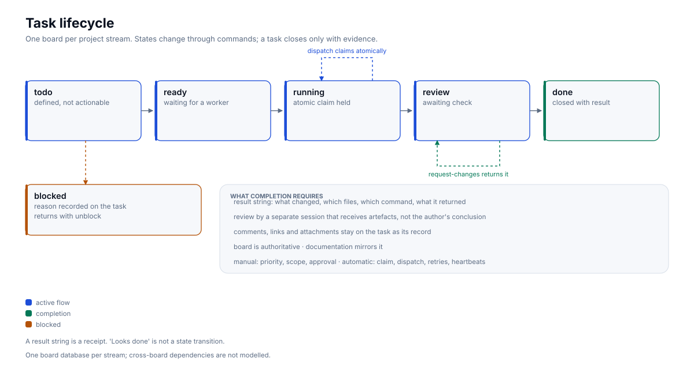

# Task orchestration

**What it is:** a SQLite-backed task board per project stream. Tasks are claimed atomically,
executed by a named profile in an isolated workspace, and closed with evidence.

## States

| State | Meaning | Entered by |
|---|---|---|
| `triage` | captured, not yet shaped | creation with a triage flag |
| `todo` | defined, waiting on a parent or on promotion | creation with an open parent, unblock, reopen |
| `ready` | actionable and dispatchable | creation (default), assign, promote, unblock |
| `running` | a worker holds an atomic claim | dispatcher or explicit claim |
| `review` | implementation claims done, awaiting a check | `request-review` |
| `done` | closed with evidence | `complete` (review approval is exempt) |
| `blocked` | cannot proceed — reason recorded | `block` |
| `scheduled` | waiting on time, not on a human | `schedule` |
| `archived` | off the active board, kept for history | `archive` |

Review can send work back with `request-changes`; `reopen-review` reverses an approval;
`unblock` re-gates on parents: back to `ready`, to `todo` while a parent is unfinished, or
straight back to `review` when that is where it stopped.

## How a task is executed

1. **Intake.** Title, body, priority, optional assignee, workspace mode, and optionally a
   parent task.
2. **Dispatch.** A dispatcher loop takes `ready` tasks whose assignee is dispatchable and
   claims one atomically — a worker id and a claim expiry — so two workers cannot take the
   same task.
3. **Execution.** The worker runs as that profile in its own workspace (`scratch`, a git
   worktree, or an explicit directory), with the task body as the brief. Model, provider, skill
   list, retry budget and maximum runtime can be pinned per task.
4. **Result.** `complete` is refused unless it carries a non-empty result: what was actually
   done, which files changed, which command ran and what it returned. Empty or whitespace-only
   evidence raises an error; approving a task out of `review` is the one exemption. The gate
   checks that the field is filled, not whether it is honest — that is what review is for.
5. **Review.** `request-review` hands the artefact to a separate session; approval closes it,
   rejection returns it with comments.
6. **Record.** Comments, links, attachments, run history and heartbeats stay on the task.

## What is automatic and what is manual

| Automatic | Manual |
|---|---|
| Claiming, dispatch, heartbeats, retries, failure counters | Scope and priority decisions |
| Status transitions through the documented commands | Approving a review |
| Workspace and branch creation per task | Choosing when to archive |
| Dependency ordering inside a board | Deciding what the board should contain |

## Dependencies and scope

Tasks can depend on other tasks inside the same board (parent → child links); a blocked parent
holds its children. Boards are separate databases, so a dependency **across** boards is not
modelled — that is a human coordination step, not a software one.

## Why it works

- **No double work.** An atomic claim makes parallel workers safe.
- **Evidence-based closure.** A result string plus a review step beats "looks done".
- **Resumable.** A new session reads the board and continues without guessing.
- **Bounded blast radius.** Each task runs in its own workspace.

## Limits

- No capacity planning: dispatch does not know how loaded a worker is.
- Review quality depends on the reviewer's brief, not on the tool.
- The board is shared between profiles; access control is by convention, not by permission.

→ [Architecture](architecture.md) · [Roles](roles.md)
