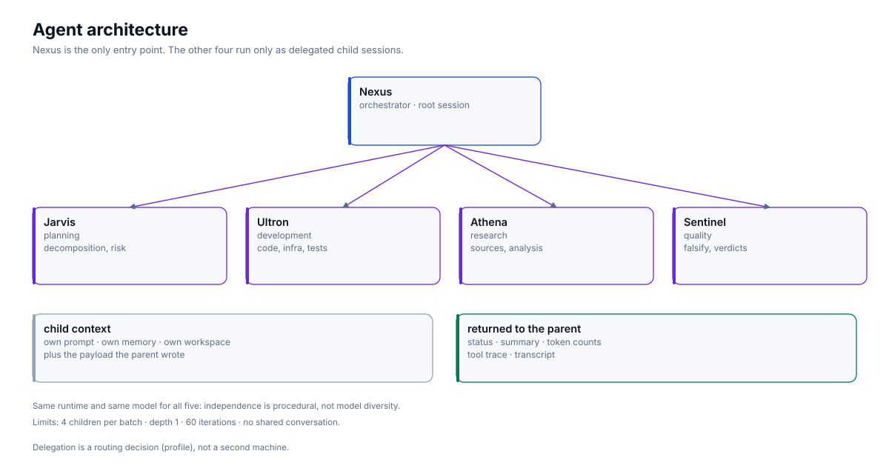

# Agents and roles

**What it is:** five profiles in one Hermes installation. Same runtime, same model, same tool
configuration — different persona, memory and workspace.

| Agent | Role | Responsibility |
|---|---|---|
| **Nexus** | Orchestrator | Understands the request, plans, delegates or executes, verifies, assembles the result |
| **Jarvis** | Planning | Decomposition, dependency order, risk, stop conditions |
| **Ultron** | Development | Code, infrastructure, tests, debugging; reports files and exit codes |
| **Athena** | Research | Primary sources, technical analysis, documentation |
| **Sentinel** | Quality assurance | Tries to falsify the work; per-claim verdicts |

## How work reaches an agent

- **Nexus** receives everything first, from the gateway.
- The other four are **children**: they start only through a delegation call from Nexus, which
  names the profile, the goal and the payload.
- A child returns a structured result: status, summary, token counts, tool trace, transcript
  path. The parent must re-read the artefact before believing it.

## What the profiles actually share

| Shared | Per profile |
|---|---|
| Runtime, model and provider connection | Persona and working method |
| Tool layer and MCP servers | Memory notes |
| One control node | Skills |
| One task board | Session store |
| — | Workspace directory |

**All five run the same model, and the same tool configuration.** That matters twice over.
Sentinel is independent in *method* — a separate session, no access to the author's
conversation, an adversarial brief — not in *model*, and not in *privilege*: it can run exactly
the same commands as Ultron. A shared blind spot is not caught by a sibling with the same eyes,
and a role is not a security control.

The real boundaries are outside the profiles: what the whole installation can reach (one host,
its SSH targets, one GUI workstation) and what the human authorises (`sudo`, network changes,
irreversible operations).

## Limits

| Limit | Value |
|---|---|
| Children per batch | 4 |
| Delegation depth | 1 (children cannot delegate) |
| Iterations per child | 60 |
| Shared context between parent and child | none, beyond the payload |
| Tool configuration | identical across profiles |

→ [Architecture](architecture.md) · [Kanban](kanban.md) · [Caching](caching.md)
