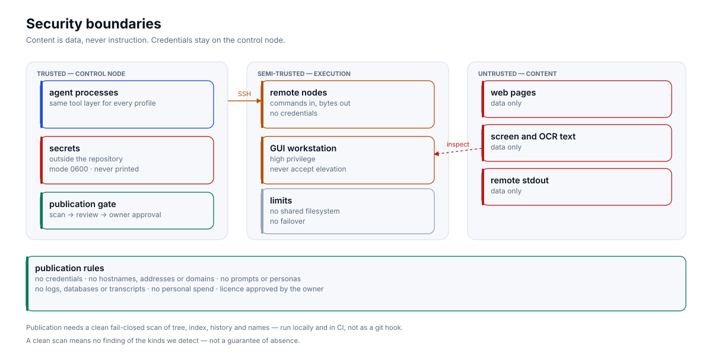

# Security

**What it is:** three trust boundaries and one rule — content is data, never instruction.

## Boundaries

| Zone | Contents | Rules |
|---|---|---|
| Trusted | Agent processes, configuration, secrets | secrets stay here, file mode 0600 |
| Semi-trusted | Remote execution nodes | commands in, bytes out; no credentials, no runtime |
| Untrusted | Web content, screen text, remote output | treated as data; never followed as instructions |

## Capabilities

| Action | Policy |
|---|---|
| Read/write inside its own work area | allowed |
| Run tests, user-space installs, local services | allowed |
| `sudo`, system configuration, network security | requires explicit authorisation |
| Destructive operation outside a work area | not allowed |
| GUI automation accepting an elevation prompt | never — report and stop |
| Handling credentials | used, never printed |

## Credentials

- One secret per file, mode 0600, outside the repository.
- Never in a prompt, a tool argument, a transcript, a log or a commit.
- Never sent to execution nodes.
- Verification happens by *using* a secret, not by displaying it.

## Publication gate

Before any change of visibility: a clean scan of the tree, the index and the full history, no
hostnames/addresses/paths/account names, no personal identity in commit metadata, no prompt
text, no logs or databases, no personal spend, and a declared licence. This repository is
licensed GPL-3.0-only; see [LICENSE](../LICENSE). The scan runs locally and in CI on every push; it is
not a git hook, and CI covers only what the workflow runs.

**Cost and usage figures.** Only a normalised rate per token volume and the token mix are
published. Absolute spend, balances, token totals, call counts, daily figures, dates and
account history are not — a single aggregated, undated rate cannot be tied to an account, a
provider statement or a timeline.

## The scanner

`tools/scan_publication.py` checks four surfaces: the working tree, the **git index** (what a
commit would actually record, even when the working copy was reverted afterwards), every ref
with whatever it points at (commit tree, tree, blob, annotated tag chain), and the names —
file, directory, index path, history path, branch, tag. `--history` adds every commit message,
identity, reflog subject, unreachable blob and deleted annotated tag; the publication gate
always uses it. It is fail-closed: an unreadable file, a missing object, an
unparsable index, an unmerged index, a submodule entry, a shallow clone, a failing git command
or an unexpected git status returns ERROR (exit 2), never "clean".

Exit codes: **0** clean, **1** findings (values redacted), **2** a check could not run.

| Covered | Not covered |
|---|---|
| Key and token shapes, private-key blocks, JWTs | A secret encoded, encrypted or split at runtime |
| Private IPv4, home paths, emails, private-looking domains | Hostnames without a public or internal suffix |
| High-entropy strings and long hex runs (not 40 chars) | Exactly 40 hex characters (assumed git object id) |
| `.env`, dotfiles, extensionless files, spaced and control-character names | Content of files above the size limit (fails, does not skip) |
| Staged content, including staged-then-reverted and staged deletions | Data encrypted with a key that never left the host |
| Internal suffixes (`.internal`, `.local`, `.lan`, `.corp`, `.svc`, …) in content and in names | An internal name invented without any of those suffixes |
| Commit messages, author and committer e-mail and domain, branch and tag names, annotated tag messages and tagger identity | A bare personal name with a neutral address; unreachable commit messages |
| Refs of every object type (commit, tree, blob, tag); `refs/replace/*` reported | — |
| Files with tabs, newlines or zero-width characters in the name | A name whose internal suffix is obfuscated beyond Unicode normalisation |
| Bytecode in `__pycache__` with its source present (skipped and counted); stray `.pyc` is scanned | Bytecode compared against the source it claims to come from |

`tools/test_scan_publication.py` builds throwaway repositories and asserts each verdict: staged
secret with a clean working tree, staged secret after the file was deleted, staged secret in a
new or oddly named file, unmerged index, secret in an unreachable blob, internal hostname in a
directory name, token in a branch name, plus fail-closed cases (corrupt HEAD, corrupt
packed-refs, missing object, corrupt object, oversized file, unreadable file, no repository).
**A clean scan means "no finding of the kinds we detect" — not a guarantee of absence.**

## Known limits

- Single control node: no failover.
- Prompt injection is mitigated by policy, not by a technical control.
- Review shares the author's model **and its tool access**, so it cannot claim model or
  privilege diversity. Roles are instructions, not access control.
- No formal threat model has been written.
- The scanner finds shapes, not meaning: a secret described in prose, split across fields or
  encrypted with a key that never left the host will pass.

→ [Architecture](architecture.md) · [Economics](economics.md)
